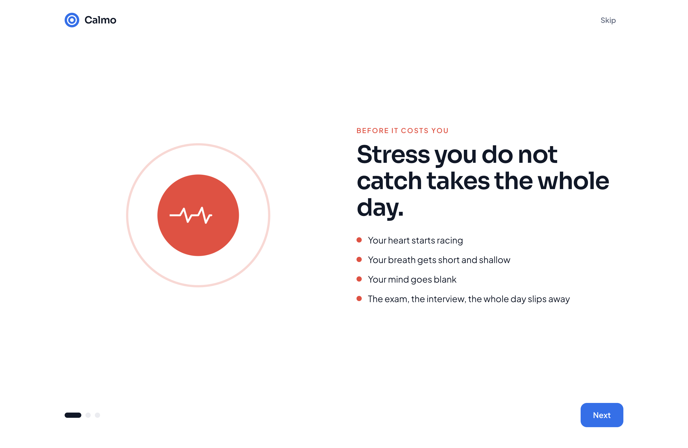
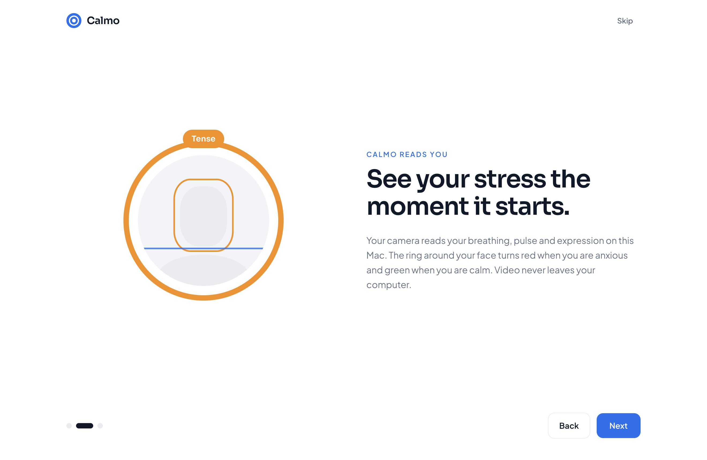
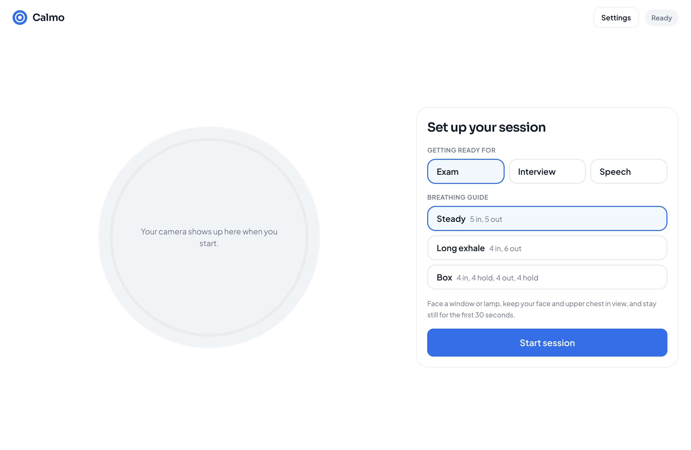
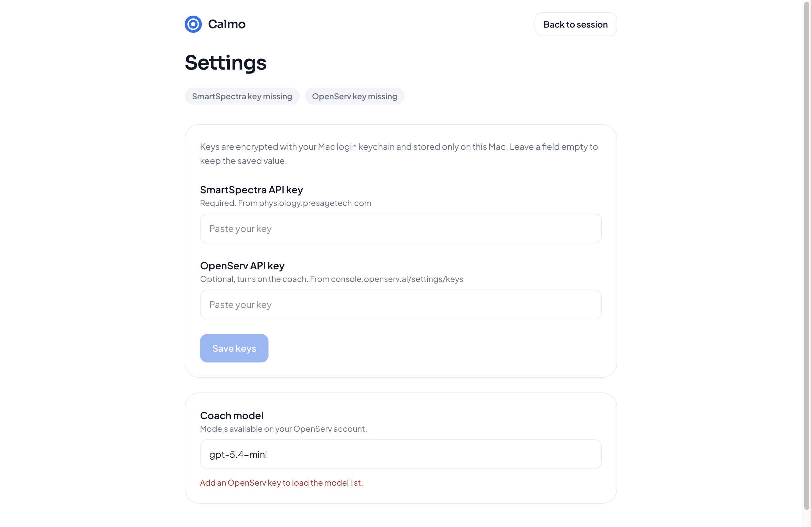

<p align="center">
  
</p>

<h1 align="center">Calmo</h1>

<p align="center">Fix your emotional stress before it ruins your day.</p>

Calmo reads your breathing, pulse and expression through your webcam, shows when you are anxious or tense, and coaches you back to calm before an exam, interview or talk. It runs as a Mac app or a local web app.

<p align="center">
  
  
</p>
<p align="center">
  
  
</p>

## What it does

- **Round camera with a breathing ring** that grows and shrinks with your guide: Steady (5 in, 5 out), Long exhale (4 in, 6 out) or Box (4, 4, 4, 4).
- **State ring** from red to green: Anxious, Angry, Stressed, Tense, Settling, Calm. It uses your expression, breathing rate and pulse, and a box tracks your face.
- **Coach** (OpenServ) that reads your live numbers and tells you what to do right now, then checks in when you finish. Pick the model from a dropdown.
- **Summary** of how your breathing, pulse and HRV changed, and whether you went from Anxious to Calm.

Vitals come from the [SmartSpectra SDK](https://smartspectra.presagetech.com) and are computed on your computer.

## Mac app

Download `Calmo-0.1.0-arm64.dmg` from [Releases](https://github.com/fozagtx/Calmo/releases) and drag Calmo into Applications. Apple Silicon only. The build is not notarized, so the first time, right-click Calmo and choose Open.

Open **Settings**, paste your keys, then start a session:

- SmartSpectra key (required): https://physiology.presagetech.com
- OpenServ key (optional, turns on the coach): https://console.openserv.ai/settings/keys

Keys are encrypted with your Mac login keychain.

## Web app (local)

```bash
git clone https://github.com/fozagtx/Calmo.git
cd Calmo
npm install
cp .env.example .env
npm run dev
```

Put your keys in `.env`, then open http://127.0.0.1:5173. Requires Node 22.9 or newer.

## Build from source

```bash
node node_modules/electron/install.js
npm run dev:mac      # Mac app with live reload, reads keys from .env
npm run build:mac    # release/Calmo-0.1.0-arm64.dmg
npm run check        # TypeScript strict
```

## Privacy

Video never leaves your computer and nothing is recorded or saved. SmartSpectra telemetry is off. The coach only receives numbers (breathing, pulse, HRV, expression label, state) and what you type.

Calmo gives general wellness feedback. It is not a medical device.

Built for the Presage SmartSpectra SDK Challenge. See [SUBMISSION.md](SUBMISSION.md).
