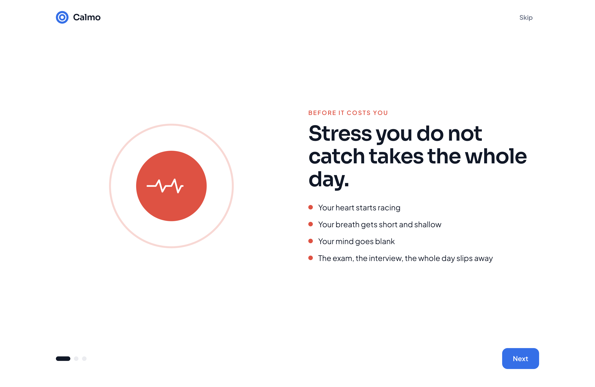
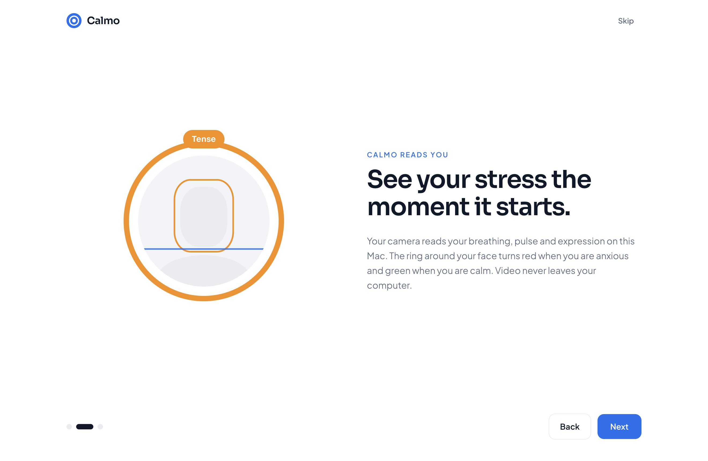
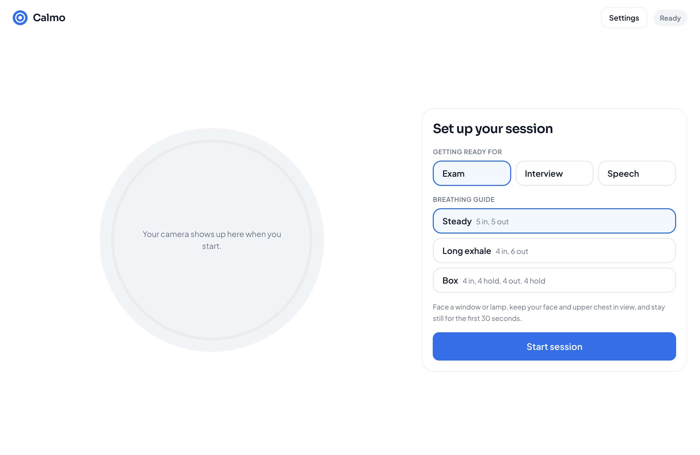
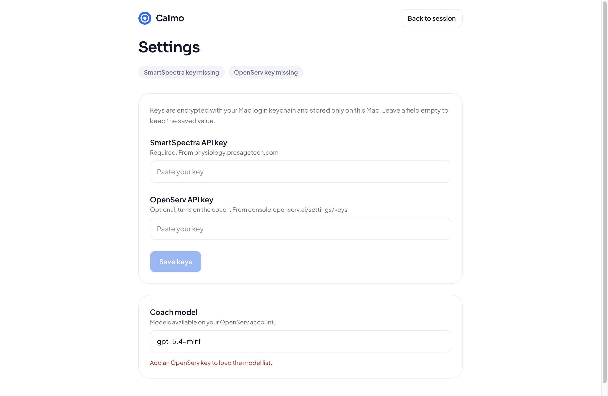

*This is a submission for the [Presage SmartSpectra SDK Challenge](https://dev.to/challenges/presage-2026-11-04)*

## What I Built

**Calmo** helps you fix your emotional stress before it ruins your day.

It is for the minutes before something that matters: an exam, a job interview, a talk. You sit in front of your webcam. Calmo reads your breathing, pulse, heart rate variability and facial expression with the SmartSpectra SDK, shows your state on a ring around your face, paces your breathing, and a coach tells you what to do right now to settle.

- A **round live camera** with a breathing ring around it. The ring grows as you breathe in and shrinks as you breathe out, using one of three guides: Steady (5 in, 5 out), Long exhale (4 in, 6 out) or Box (4, 4, 4, 4).
- A **state ring** that colours your face from red to green: Anxious, Angry, Stressed, Tense, Settling, Calm. A box tracks your face inside the circle.
- A **"You started / Right now"** strip, so you watch yourself flip from Anxious to Calm.
- A **coach** that reads your live numbers and gives one concrete action, then an **after-session check-in** with what changed. You pick the coach model from a dropdown.
- A short **onboarding** on first launch of the Mac app: three animated screens on what uncontrolled stress does to your day, how Calmo reads you, and how you breathe back to calm.

Calmo runs two ways from one codebase: a **Mac app** (Electron) and a **local web app** (Vite, TanStack Router and Query, TypeScript).

## Demo

TODO: add your demo video link here.

## Code

https://github.com/fozagtx/Calmo

- Mac app (Apple Silicon): download the DMG from [Releases](https://github.com/fozagtx/Calmo/releases/tag/v0.1.0)
- Web app: `npm install`, add keys to `.env`, `npm run dev`

The README covers setup for both.

## How It Responds to Human Signals

Calmo requests three SmartSpectra metric groups: `breathingMetrics`, `cardioMetrics` and `faceMetrics`.

| Signal | When it appears | What Calmo does with it |
| --- | --- | --- |
| Pulse rate | about 12 s | Shown live. A pulse of 88 bpm or more pushes the state toward Tense or Stressed. A drop of 4 bpm below your starting pulse counts toward Calm. |
| Breathing rate | about 30 s | Compared with your chosen guide. On pace, faster or slower than the guide is shown live, and time on pace is reported at the end. |
| Chest breathing trace | about 30 s | Drawn as a live 20 second waveform so you can see yourself follow the ring. |
| HRV (RMSSD) | about 60 s | Shown live and compared start to end in the summary. |
| Expressions | live | Fear or surprise reads as Anxious. Anger, contempt or disgust reads as Angry. Happy counts toward Calm. |
| Blinking and talking | live | Blink rate per minute and a talking flag, passed to the coach as context. |
| Face landmarks | live | Turned into a rounded box that tracks your face inside the circular camera, coloured by your state. |

**The state ring.** Calmo scores expression, breathing and pulse together on every metrics packet. A new state must hold for 3 seconds before the ring changes colour, so it does not flicker. The first steady state is remembered. When you reach Calm from Anxious, Angry, Stressed or Tense, Calmo marks the moment: "You went from Anxious to Calm."

**Only steady readings count.** Calmo uses each sample's `stable` flag and `confidence`, shows a warm-up countdown until a metric's window fills, and surfaces the SDK's `validationStatus` hint text (for example "No face found") under the camera exactly as the SDK sends it.

**The coach.** When you ask for help, Calmo sends the coach model (OpenServ SERV Reasoning, `gpt-5.4-mini`) only numbers and labels: breathing rate, pulse, HRV, expression label, blink rate, current and starting state, your breathing guide, and your message. It replies in two to four sentences with one action, such as stretching the exhale to match the ring, dropping your shoulders, or a grounding line. When the session ends, it gets the start and end averages and does a check-in.

**How I integrated the SmartSpectra SDK**

- **Mac app.** The renderer uses `@smartspectra/node-sdk/renderer`, the main process calls `bindSmartSpectraIpc(window)`, and Calmo's preload bundles `@smartspectra/node-sdk/preload` next to its own small bridge. The SDK acquires the camera, emits `streamAvailable` for the round preview, and processes frames in the main process. The packaged app ships the native runtime as an extra resource and points `SMARTSPECTRA_CAPI_PATH` at it.
- **Web version.** The browser captures the camera, draws frames to a canvas and streams RGBA frames with monotonic microsecond timestamps over a local WebSocket. The Node SDK runs with `useCustomInput()` and `sendFrame()`. Metrics come back as raw protobuf and are decoded in the browser with `decodeMetrics` from `@smartspectra/node-sdk/messages`.
- **Shared.** Both paths expose the same events (`processingStatus`, `validationStatus`, `metrics`, `error`), so the UI does not care which one is running. On a retryable error such as a brief network drop, Calmo calls `reset()` and `start()` again, up to 3 times, and keeps your readings.

## Prize Categories

**Best Thoughtful Real-World Use.**

Exam, interview and stage nerves are common and they hit at a predictable moment, usually minutes before, when you are alone with a laptop. Most breathing apps give the same timer to everyone and never check whether it is working. Calmo closes that loop: it measures whether your breathing actually matches the guide, whether your pulse is coming down, and whether your face has relaxed, and it tells you so in plain words.

Designed for that moment:

- No wearable, no account. A normal webcam is enough.
- One screen, one focal point. Your face sits in the breathing ring, so there is nothing else to look at.
- Plain language throughout. States are words people use (Anxious, Tense, Calm), not scores.
- Honest warm-up. Readings stay grey until they are steady, with a countdown, instead of showing early numbers.
- Quick to use. Three to five minutes before you walk in.

## Consent and Data Handling

**Camera consent**

- Nothing starts until you press **Start session**.
- **Mac app:** macOS shows its own camera permission prompt with Calmo's reason ("Calmo uses your camera to read breathing, pulse and expression on this Mac. Video never leaves your computer."). Inside the app, camera access is granted only to Calmo's own bundled page, video only, never the microphone. Navigation to outside pages is blocked.
- **Web version:** the browser's standard camera prompt. The page asks for video only, with no audio.
- **End session** stops the camera immediately.

**What happens to the video**

- Video is processed on your computer and is never recorded, saved or uploaded.
- In the web version, frames travel from the browser to the Node process on the same machine over a localhost connection and are discarded after processing.

**What is stored**

- Calmo saves no video, no vitals and no session history. Readings, chat and summary live in memory and are gone when you start a new session or close the window.
- API keys: on the Mac they are encrypted with macOS `safeStorage` (backed by your login keychain) in Calmo's app data folder. In the web version they live in a local `.env` file that git ignores.

**SDK network use and telemetry**

- The SmartSpectra SDK contacts Presage only to validate the API key and subscription. Metrics are computed on the device.
- Calmo turns off SDK telemetry (`enableTelemetry: false`), so no session summaries or readiness reports are sent.

**Optional AI service**

- The coach is optional and only runs when you add an OpenServ key and send a message, or when a session ends.
- It receives numbers and labels (breathing rate, pulse, HRV, expression label, blink rate, estimated state, breathing guide), plus what you type. It never receives video, images or face data.
- Those requests are handled by OpenServ under its own terms.

**Not medical.** Calmo gives general wellness feedback only. It does not diagnose, treat or make medical decisions, the coach is instructed not to give medical advice, and the state ring is an estimate, not an assessment. There is no covert monitoring: the camera runs only while you can see yourself in the circle.

## Agent Session

TODO (optional): embed your agent session here.
